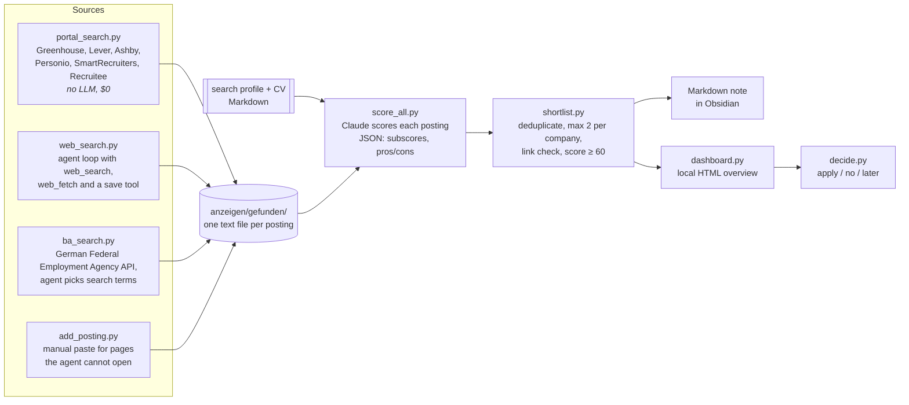

# internship-search-agent

An LLM-powered pipeline that finds internship postings, scores them against a personal search profile and produces a weekly shortlist. Built with Python and the Anthropic Messages API (Claude Haiku), including tool use, an agent loop with web search, and an evaluation against my own blind ratings.

> **User-facing language: German.** The code, comments and CLI options are in English. Terminal output, prompts, the dashboard, the shortlist notes and the data files (`ergebnisse/`, `anzeigen/`, CSV columns) are in German, because I use the tool myself for internships in Germany and Portugal.

## Problem

Searching for a summer internship means dozens of job boards, company career pages and applicant portals, and most postings do not fit. Reading them all takes hours every week. I wanted a tool that

- collects postings from several sources automatically,
- scores each posting against an explicit, written search profile (not a vague "is this good?"),
- removes duplicates across sources and shows only the best 3–5 per week,
- stays cheap and never sends anything on my behalf.

## How it works



`weekly_run.py` runs the whole chain with one command.

**Design choices**

- **Workflow first, agent only where it helps.** Only the open-ended web search is an agent loop. Applicant portals are queried directly via their public APIs, which is cheaper, faster and more reliable.
- **The profile is the configuration.** Scoring rules (weights, no-gos, calibration examples) live in a Markdown file, not in the code. Changing the profile changes the ranking without touching Python.
- **Structured output.** The model returns JSON with subscores (content, company, start date, duration, reputation, penalties), so every score can be traced.
- **No auto-apply.** The tool only suggests. Decisions and applications stay manual.

## Evaluation

An LLM score is only useful if it ranks postings the way I would. So I built small test sets: postings spread over the whole score range, which I rated **blind** (before seeing the agent's score). `evaluate.py` compares both.

| | Test set 1 (first prompt) | Test set 3 (profile v2.2) |
|---|---|---|
| Postings compared | 9 | 9 |
| Mean absolute deviation | 34.8 points | 16.0 points |
| **Spearman rank correlation** | **0.34** | **0.86** |

What changed in between: a structured interview about my preferences, pairwise comparisons of made-up postings to calibrate the weights, adding the CV for a separate "chances" field, a minimum threshold for content fit, and test set 2 with new, unseen postings to avoid tuning on the same data.

Caveat: the test sets are small (n = 9 each), so the numbers show a clear direction, not a precise accuracy.

## Cost limits

Every script has hard limits so a bug cannot burn money:

| Script | Limit | Typical cost |
|---|---|---|
| `web_search.py` | max. 8 iterations, ~8 searches, 20 fetches, 10 saved postings, aborts above $0.20 | $0.10–0.15 per run |
| `ba_search.py` | max. 10 API calls, 15 searches | < $0.05 |
| `score_all.py` | max. 40 postings per run, already scored postings are skipped | ~$0.002 per posting |
| `portal_search.py`, `shortlist.py`, `dashboard.py`, `decide.py`, `add_posting.py` | no LLM | $0 |

The default weekly run (portals → scoring → shortlist) costs about $0.02–0.05. `max_tokens` caps each call, and the API account is prepaid without auto-reload.

## Setup

Requires Python 3.9+ and an [Anthropic API key](https://console.anthropic.com/).

```bash
git clone https://github.com/eneasminxolli/internship-search-agent.git
cd internship-search-agent
python3 -m venv .venv
source .venv/bin/activate
pip install -r requirements.txt
cp .env.example .env          # then add your ANTHROPIC_API_KEY
```

Without further configuration the scripts use the fictional profile and CV in `example/`. To use your own, edit those files, or set `VAULT_PATH` in `.env` to an Obsidian vault (see `config.py` for the expected file names).

## Usage

```bash
python score_posting.py example/posting.txt   # score a single posting (~$0.002)

python weekly_run.py                    # portals -> scoring -> shortlist -> dashboard
python weekly_run.py --with-web-search  # additionally run the web search agent
python weekly_run.py --shortlist-only   # rebuild shortlist and dashboard only ($0)

python decide.py                        # go through the shortlist: b = apply, n = no, s = later
python add_posting.py <link>            # add a posting manually (text from the clipboard, macOS)

python test_set.py --set 3              # build a blind test set
python evaluate.py --set 3              # compare your ratings with the agent's
```

Edit the company list in `portal_search.py` (`COMPANIES`) and run `python portal_search.py --detect` once to find out which applicant portal each company uses.

## Project structure

```
config.py          paths: vault (VAULT_PATH) or example/
score_posting.py   score one posting (prompt + JSON parsing)
score_all.py       score all new postings -> ergebnisse/agent_scores.csv
web_search.py      agent loop: web_search, web_fetch, custom save tool
ba_search.py       agent with two client tools for the BA job API
portal_search.py   applicant-portal APIs, no LLM
add_posting.py     manual input for pages the agent cannot fetch
shortlist.py       deduplication, selection, link check, Markdown note
dashboard.py       local HTML dashboard
decide.py          keyboard-driven status updates
weekly_run.py      runs everything in order
test_set.py, evaluate.py   blind evaluation
example/           fictional profile, CV and posting
```

## Roadmap

- [x] 1. Search profile
- [x] 2. First API call: score one posting
- [x] 3. Tool use and web search, evaluation against blind ratings
- [x] 4. Storage, deduplication, weekly shortlist
- [ ] 5. Draft a tailored CV and cover letter per selected posting (drafts only, no auto-send)
- [ ] 6. Automation: scheduled weekly run (e.g. via the Claude Agent SDK)
- [ ] Tests (pytest) for deduplication and scoring helpers

## License

MIT, see [LICENSE](LICENSE).
